  

  I build <b>AI agents</b> and the <b>real-time data pipelines</b> behind them — 
  streaming ingestion, LLM labeling &amp; evaluation, and agents you can configure in plain language.

  

 

<h3 align="center">🚀 Projects</h3>

  
  

 

<h3 align="center">🎮 Community Connect Four</h3>

<!-- CONNECT4:START -->

  <b>Anyone can play.</b> It's 🔵 <b>Cyan</b>'s turn — click a column to drop a disc.

  🎯 0 moves · 🏁 0 games · 👥 0 players · 🔵 0 : 0 🟣

Recent moves &amp; how it works

| Team | Column | Player |
| :-- | :-: | :-- |
| — | — | Be the first! |

Clicking a column opens a pre-filled issue. A GitHub Action reads the title, drops the disc, redraws the board and closes the issue.

<!-- CONNECT4:END -->

 

<h3 align="center">✍️ Writing</h3>

  <a href="https://eemonzili.github.io/2025/10/28/TCP+HTTPS%E8%BF%9E%E6%8E%A5%E8%BF%87%E7%A8%8B/">TCP 与 HTTPS 连接过程</a> &nbsp;·&nbsp;
  <a href="https://eemonzili.github.io/2025/10/29/%E4%BC%98%E7%A7%80%E7%9A%84%E5%8D%9A%E5%AE%A2/">优秀的博客</a> &nbsp;·&nbsp;
  <a href="https://eemonzili.github.io/"><b>More on my blog →</b></a>

